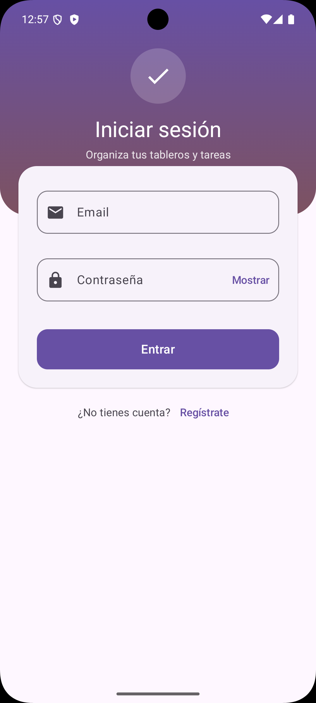
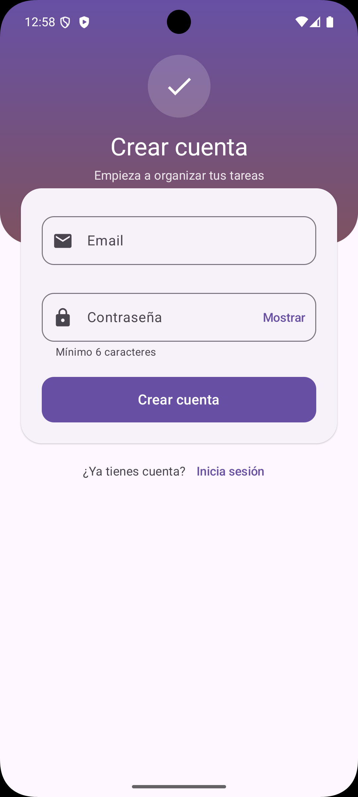
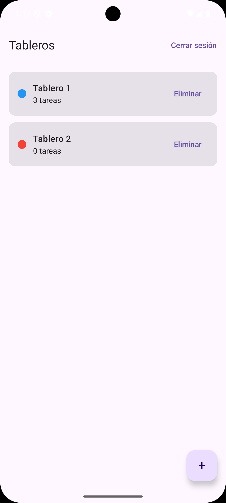
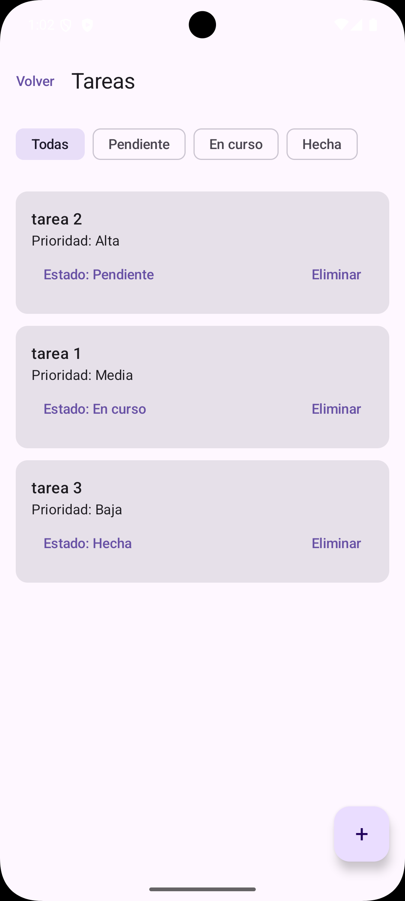
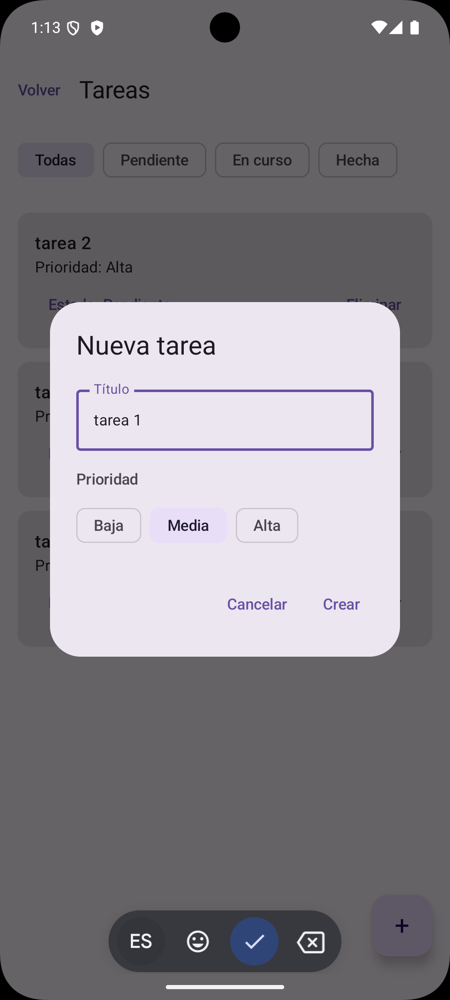
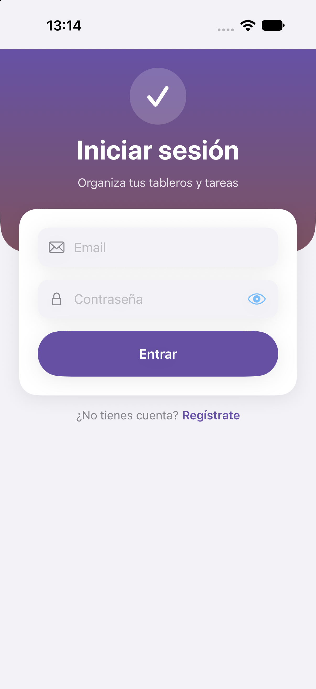
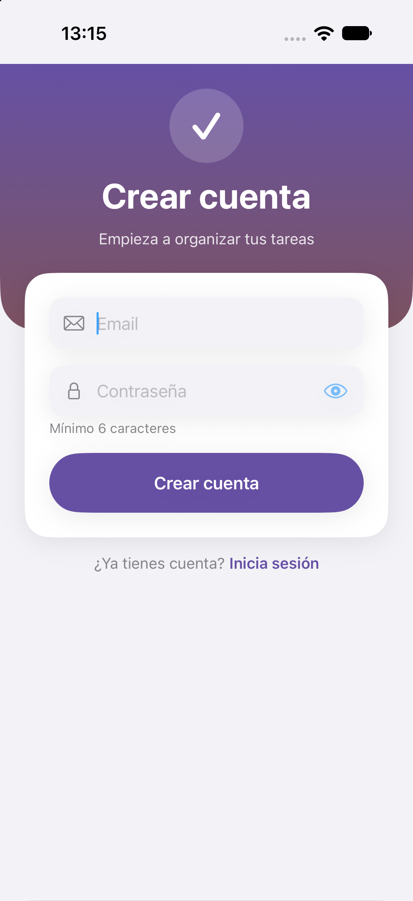
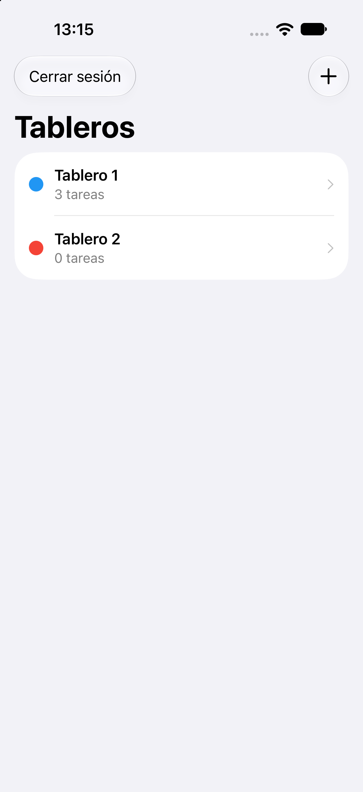
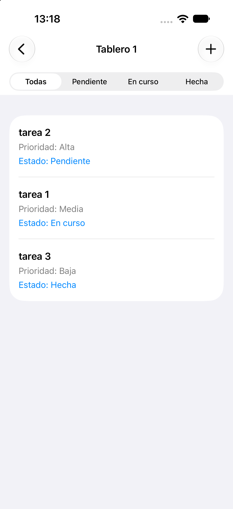
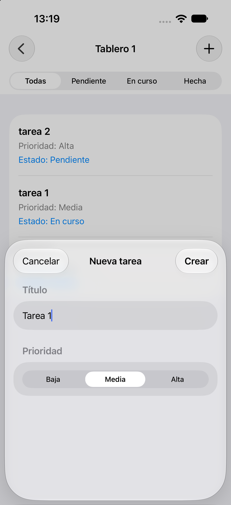

# Task Manager KMP

A board-based task manager built with **Kotlin Multiplatform**. Networking, business rules and screen state are written once in Kotlin; each platform keeps a fully **native UI** — Jetpack Compose on Android and SwiftUI on iOS.

---

## 📱 Screenshots

### Android (Jetpack Compose)

<p align="center">
  
  
  
  
  
</p>

### iOS (SwiftUI)

<p align="center">
  
  
  
  
  
</p>

---

## ✨ Features

- 🔐 **Authentication** — Sign in or create an account with email and password (Firebase Auth), from the same screen
- 📋 **Boards** — Create boards and browse them
- ✅ **Tasks** — Create tasks with priorities (High, Medium, Low) and statuses (To Do, In Progress, Done), change their status and delete them
- 🔎 **Filtering** — Filter the task list
- 📱 **Two native apps, one core** — The same shared logic drives both UIs, so validation, errors and flows behave identically

> The app interface is currently in Spanish.

---

## 🛠️ Tech Stack

| Layer | Technology |
|---|---|
| Shared logic | Kotlin Multiplatform (Kotlin 2.4.20) |
| Networking | Ktor client 3.6.1 + kotlinx.serialization 1.12.0 |
| Async and state | Coroutines 1.11.0 + `StateFlow` |
| Android UI | Jetpack Compose (BOM 2026.09.00), Material 3, Navigation Compose |
| iOS UI | SwiftUI, `@Observable`, `NavigationStack` (iOS 17+) |
| Kotlin ↔ Swift | SKIE 0.10.15 |
| Authentication | Firebase Auth, native SDK on each platform, behind a shared interface |
| Backend | .NET 10 REST API (Clean Architecture) on Google Cloud Run, Cloud Firestore |
| Logging (iOS) | swift-log |
| Build | Gradle 9.6.0, Android Gradle Plugin 9.5.0 |
| Testing | `kotlin.test` + Turbine (shared), JUnit 5 + MockK + Turbine (Android), Swift Testing + XCTest UI (iOS) |

---

## 🏗️ Architecture

```
                      ┌────────────────────────── sharedLogic (Kotlin) ──────────────────────────┐
 Jetpack Compose ─┐   │                                                                           │
                  ├──►│  Stores (StateFlow)  ──►  Use cases  ──►  Repositories  ──►  Ktor ──► API │
 SwiftUI ─────────┘   │                                              ▲                            │
                      └──────────────────────────────────────────────┼────────────────────────────┘
                                                      AuthRepository / TokenProvider (interfaces)
                                                                     ▲
                                               Firebase Auth, implemented natively per platform
```

```
task-manager-kmp/
├── sharedLogic/             # Kotlin Multiplatform module (Android + iOS framework)
│   ├── core/                # AppResult, AppError (Result pattern, no exceptions)
│   ├── domain/              # Models, use cases, repository interfaces
│   ├── data/                # Ktor client, DTOs, mappers, repository implementations
│   ├── presentation/        # Stores (login, boards, tasks) + ScreenScope
│   └── AppContainer         # Composition root
├── androidApp/              # Jetpack Compose UI + thin ViewModels + Firebase implementations
└── iosApp/                  # SwiftUI UI + @Observable ViewModels + Firebase implementations
```

---

## 🧭 Technical Decisions

- **Shared logic, native UI.** The shared module owns everything that is not drawing pixels: API access, validation, use cases and screen state. Each platform only paints a `StateFlow` and forwards user events, so there is no UI toolkit lock-in and no business logic to keep in sync twice.
- **Result pattern instead of exceptions.** Repositories and use cases return `AppResult<T>` with a sealed `AppError`. Business failures are values the UI must handle, never thrown across the Kotlin/Swift boundary.
- **Stores receive their `CoroutineScope`.** On Android the scope is the `viewModelScope`; on iOS it is a `ScreenScope` that the ViewModel closes in `deinit`. Work is cancelled when the screen goes away on both platforms without the stores knowing about either lifecycle.
- **SKIE for a Swift-friendly API.** `suspend` functions become `async`, `StateFlow` becomes an `AsyncSequence` (`for await`) and Kotlin enums and sealed types become Swift types. Where Kotlin names clash with `NSObject` (`description`), they are exposed under another name with `@ObjCName`. Kotlin is pinned to the version SKIE supports.
- **Authentication stays native, behind an interface.** The shared module only knows `AuthRepository` and `TokenProvider`. Android and iOS implement them with their own Firebase SDK, so the shared code has no Firebase dependency, and Ktor gets the ID token through `TokenProvider` for the bearer header.
- **Sign in and sign up share one flow.** The login store has an `AuthMode`; the screen only switches it. The validation rules (including the minimum password length required to sign up) live in the store and are tested once.
- **Manual dependency injection.** `AppContainer` is the composition root and builds the stores. There is no DI framework, which keeps the project small; the cost is that wiring lives in one class.
- **Thin ViewModels.** Android and iOS ViewModels only mirror the store state for their UI framework and cancel the work when they disappear.
- **Tests at every layer, with hand-written fakes.** Mapping, repositories (against Ktor's `MockEngine`), use cases and stores are tested once in shared code, with Turbine for `Flow`s. Each platform adds its ViewModel tests, and iOS adds UI tests for the login and sign-up flows. More than 160 tests in total.
- **Shared .NET 10 API.** Business rules live on the server; the apps send the Firebase ID token. One backend serves all the apps in this portfolio.

### Other projects in this portfolio

| Project | Platform | Language |
|---|---|---|
| [finance-tracker](https://github.com/gcalvarez93/finance-tracker) | Flutter (iOS + Android) | Dart |
| [habit-tracker](https://github.com/gcalvarez93/habit-tracker) | Flutter (iOS + Android) | Dart |
| [task-manager](https://github.com/gcalvarez93/task-manager) | iOS | Swift |
| [task-manager-kmp](https://github.com/gcalvarez93/task-manager-kmp) | Android + iOS | Kotlin Multiplatform + Swift |
| [budget-scanner](https://github.com/gcalvarez93/budget-scanner) | iOS | Swift |
| [recipe-manager](https://github.com/gcalvarez93/recipe-manager) | Android | Kotlin |
| [workout-tracker](https://github.com/gcalvarez93/workout-tracker) | Android | Kotlin |
| [castrodev-api](https://github.com/gcalvarez93/castrodev-api) | Shared backend | C# (.NET 10) |

---

## 🚀 Getting Started

### Prerequisites

- JDK 17 or newer
- Android Studio (for the Android app)
- macOS with Xcode and an iOS 17+ simulator (for the iOS app)
- API running at `api.castrodev.com` or locally

### Firebase

The repository includes the configuration files of the demo Firebase project:

- `androidApp/google-services.json` (package `com.castrodev.task_manager_kmp`)
- `iosApp/iosApp/GoogleService-Info.plist` (bundle `com.castrodev.taskmanagerkmp`)

To use your own project, replace both files with yours.

### API URL

- Android: `API_BASE_URL` in `androidApp/build.gradle.kts`
- iOS: `apiBaseURL` in `iosApp/iosApp/AppConfig.swift`

### Run

```bash
# Clone the repository
git clone https://github.com/gcalvarez93/task-manager-kmp.git
cd task-manager-kmp
```

**Android** — open the project in Android Studio and run the `androidApp` configuration, or:

```bash
./gradlew :androidApp:assembleDebug
```

**iOS** — open the project in Xcode and run with `⌘R`:

```bash
open iosApp/iosApp.xcodeproj
```

Xcode builds the shared framework by itself: a Run Script phase calls `./gradlew :sharedLogic:embedAndSignAppleFrameworkForXcode` before compiling.

### Running Tests

```bash
# Shared logic (JVM and iOS simulator)
./gradlew :sharedLogic:allTests

# Android ViewModels
./gradlew :androidApp:testDebugUnitTest

# iOS unit and UI tests
cd iosApp
xcodebuild test -project iosApp.xcodeproj -scheme iosApp \
  -destination 'platform=iOS Simulator,name=iPhone 18 Pro'
```

---

## 🔗 Related

- [CastroDev API](https://github.com/gcalvarez93/castrodev-api) — Shared .NET 10 backend

---

## 📄 License

MIT © Gabriel Castro

---

---

# Task Manager KMP

App de gestión de tareas por tableros construida con **Kotlin Multiplatform**. La red, las reglas de negocio y el estado de las pantallas se escriben una sola vez en Kotlin; cada plataforma conserva una **UI totalmente nativa**: Jetpack Compose en Android y SwiftUI en iOS.

---

## ✨ Funcionalidades

- 🔐 **Autenticación** — Inicia sesión o crea una cuenta con email y contraseña (Firebase Auth), desde la misma pantalla
- 📋 **Tableros** — Crea tableros y consúltalos
- ✅ **Tareas** — Crea tareas con prioridades (Alta, Media, Baja) y estados (Por Hacer, En Progreso, Completado), cambia su estado y elimínalas
- 🔎 **Filtrado** — Filtra la lista de tareas
- 📱 **Dos apps nativas, un solo núcleo** — La misma lógica compartida mueve ambas UIs, así que la validación, los errores y los flujos se comportan igual

> La interfaz de la app está actualmente en español.

---

## 🛠️ Stack Tecnológico

| Capa | Tecnología |
|---|---|
| Lógica compartida | Kotlin Multiplatform (Kotlin 2.4.20) |
| Red | Ktor client 3.6.1 + kotlinx.serialization 1.12.0 |
| Asincronía y estado | Coroutines 1.11.0 + `StateFlow` |
| UI Android | Jetpack Compose (BOM 2026.09.00), Material 3, Navigation Compose |
| UI iOS | SwiftUI, `@Observable`, `NavigationStack` (iOS 17+) |
| Kotlin ↔ Swift | SKIE 0.10.15 |
| Autenticación | Firebase Auth, SDK nativo en cada plataforma, tras una interfaz compartida |
| Backend | API REST .NET 10 (Clean Architecture) en Google Cloud Run, Cloud Firestore |
| Logging (iOS) | swift-log |
| Build | Gradle 9.6.0, Android Gradle Plugin 9.5.0 |
| Tests | `kotlin.test` + Turbine (compartido), JUnit 5 + MockK + Turbine (Android), Swift Testing + XCTest UI (iOS) |

---

## 🏗️ Arquitectura

```
                      ┌────────────────────────── sharedLogic (Kotlin) ──────────────────────────┐
 Jetpack Compose ─┐   │                                                                           │
                  ├──►│  Stores (StateFlow)  ──►  Casos de uso  ──►  Repositorios  ──►  Ktor ──► API │
 SwiftUI ─────────┘   │                                              ▲                            │
                      └──────────────────────────────────────────────┼────────────────────────────┘
                                                      AuthRepository / TokenProvider (interfaces)
                                                                     ▲
                                          Firebase Auth, implementado de forma nativa en cada plataforma
```

```
task-manager-kmp/
├── sharedLogic/             # Módulo Kotlin Multiplatform (Android + framework iOS)
│   ├── core/                # AppResult, AppError (patrón Result, sin excepciones)
│   ├── domain/              # Modelos, casos de uso, interfaces de repositorio
│   ├── data/                # Cliente Ktor, DTOs, mappers, implementaciones de repositorio
│   ├── presentation/        # Stores (login, tableros, tareas) + ScreenScope
│   └── AppContainer         # Raíz de composición
├── androidApp/              # UI Jetpack Compose + ViewModels finos + implementaciones de Firebase
└── iosApp/                  # UI SwiftUI + ViewModels @Observable + implementaciones de Firebase
```

---

## 🧭 Decisiones Técnicas

- **Lógica compartida, UI nativa.** El módulo compartido se encarga de todo lo que no es dibujar píxeles: acceso a la API, validación, casos de uso y estado de las pantallas. Cada plataforma solo pinta un `StateFlow` y reenvía los eventos del usuario, así que no hay dependencia de un toolkit de UI ni lógica de negocio duplicada que mantener sincronizada.
- **Patrón Result en lugar de excepciones.** Los repositorios y los casos de uso devuelven `AppResult<T>` con un `AppError` sellado. Los fallos de negocio son valores que la UI debe tratar, nunca se lanzan a través de la frontera Kotlin/Swift.
- **Los stores reciben su `CoroutineScope`.** En Android el scope es el `viewModelScope`; en iOS es un `ScreenScope` que el ViewModel cierra en `deinit`. El trabajo se cancela al salir de la pantalla en ambas plataformas, sin que los stores conozcan ninguno de los dos ciclos de vida.
- **SKIE para una API cómoda en Swift.** Las funciones `suspend` pasan a ser `async`, `StateFlow` pasa a ser un `AsyncSequence` (`for await`), y los enums y tipos sellados de Kotlin se convierten en tipos de Swift. Donde un nombre de Kotlin choca con `NSObject` (`description`), se expone con otro nombre mediante `@ObjCName`. Kotlin está fijado a la versión que soporta SKIE.
- **La autenticación sigue siendo nativa, tras una interfaz.** El módulo compartido solo conoce `AuthRepository` y `TokenProvider`. Android e iOS los implementan con su propio SDK de Firebase, de modo que el código compartido no depende de Firebase, y Ktor obtiene el token de ID a través de `TokenProvider` para la cabecera bearer.
- **Iniciar sesión y registrarse comparten flujo.** El store de login tiene un `AuthMode`; la pantalla solo lo alterna. Las reglas de validación (incluida la longitud mínima de contraseña para registrarse) viven en el store y se prueban una sola vez.
- **Inyección de dependencias manual.** `AppContainer` es la raíz de composición y construye los stores. No hay framework de DI, lo que mantiene el proyecto pequeño; el coste es que el enlazado vive en una sola clase.
- **ViewModels finos.** Los ViewModels de Android e iOS solo reflejan el estado del store para su framework de UI y cancelan el trabajo cuando desaparecen.
- **Tests en cada capa, con fakes escritos a mano.** Los mapeos, los repositorios (contra el `MockEngine` de Ktor), los casos de uso y los stores se prueban una vez en código compartido, con Turbine para los `Flow`. Cada plataforma añade los tests de sus ViewModels, e iOS añade tests de UI para los flujos de login y registro. Más de 160 tests en total.
- **API compartida en .NET 10.** Las reglas de negocio viven en el servidor; las apps envían el token de Firebase. Un solo backend sirve a todas las apps de este portfolio.

### Otros proyectos del portfolio

| Proyecto | Plataforma | Lenguaje |
|---|---|---|
| [finance-tracker](https://github.com/gcalvarez93/finance-tracker) | Flutter (iOS + Android) | Dart |
| [habit-tracker](https://github.com/gcalvarez93/habit-tracker) | Flutter (iOS + Android) | Dart |
| [task-manager](https://github.com/gcalvarez93/task-manager) | iOS | Swift |
| [task-manager-kmp](https://github.com/gcalvarez93/task-manager-kmp) | Android + iOS | Kotlin Multiplatform + Swift |
| [budget-scanner](https://github.com/gcalvarez93/budget-scanner) | iOS | Swift |
| [recipe-manager](https://github.com/gcalvarez93/recipe-manager) | Android | Kotlin |
| [workout-tracker](https://github.com/gcalvarez93/workout-tracker) | Android | Kotlin |
| [castrodev-api](https://github.com/gcalvarez93/castrodev-api) | Backend compartido | C# (.NET 10) |

---

## 🚀 Instalación

### Requisitos previos

- JDK 17 o superior
- Android Studio (para la app de Android)
- macOS con Xcode y un simulador iOS 17+ (para la app de iOS)
- API disponible en `api.castrodev.com` o en local

### Firebase

El repositorio incluye los archivos de configuración del proyecto Firebase de demo:

- `androidApp/google-services.json` (paquete `com.castrodev.task_manager_kmp`)
- `iosApp/iosApp/GoogleService-Info.plist` (bundle `com.castrodev.taskmanagerkmp`)

Para usar tu propio proyecto, sustituye ambos archivos por los tuyos.

### URL de la API

- Android: `API_BASE_URL` en `androidApp/build.gradle.kts`
- iOS: `apiBaseURL` en `iosApp/iosApp/AppConfig.swift`

### Ejecutar

```bash
# Clonar el repositorio
git clone https://github.com/gcalvarez93/task-manager-kmp.git
cd task-manager-kmp
```

**Android** — abre el proyecto en Android Studio y ejecuta la configuración `androidApp`, o:

```bash
./gradlew :androidApp:assembleDebug
```

**iOS** — abre el proyecto en Xcode y ejecuta con `⌘R`:

```bash
open iosApp/iosApp.xcodeproj
```

Xcode construye el framework compartido por sí solo: una fase Run Script llama a `./gradlew :sharedLogic:embedAndSignAppleFrameworkForXcode` antes de compilar.

### Tests

```bash
# Lógica compartida (JVM y simulador iOS)
./gradlew :sharedLogic:allTests

# ViewModels de Android
./gradlew :androidApp:testDebugUnitTest

# Tests unitarios y de UI de iOS
cd iosApp
xcodebuild test -project iosApp.xcodeproj -scheme iosApp \
  -destination 'platform=iOS Simulator,name=iPhone 18 Pro'
```

---

## 🔗 Relacionado

- [CastroDev API](https://github.com/gcalvarez93/castrodev-api) — Backend compartido en .NET 10

---

## 📄 Licencia

MIT © Gabriel Castro